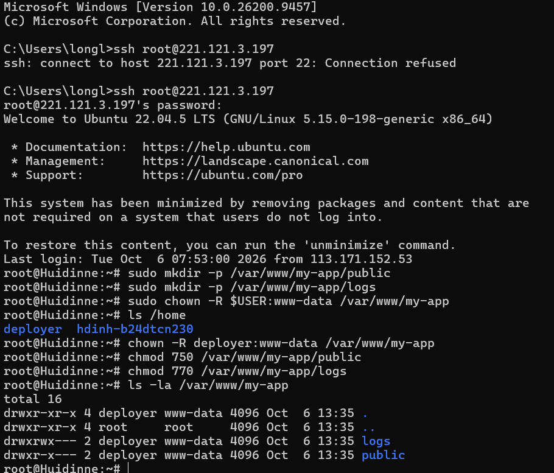

# Báo cáo Bài 1: Khảo sát FHS và Phân quyền File/Folder nâng cao

## 2. Nhật ký thực thi các câu lệnh (Terminal Log)

### Bước 1: Khởi tạo cấu trúc thư mục theo chuẩn FHS
Sử dụng quyền `sudo` để tạo cây thư mục tại `/var/www/my-app`:
```bash
sudo mkdir -p /var/www/my-app/public
sudo mkdir -p /var/www/my-app/logs
```
*Giải thích:*
- Thư mục `/var/www` theo chuẩn FHS (Filesystem Hierarchy Standard) là nơi lưu trữ dữ liệu các dịch vụ Web.
- Tùy chọn `-p` (parents) giúp tự động tạo các thư mục cha nếu chưa tồn tại.

---

### Bước 2: Thay đổi quyền sở hữu (Owner & Group)
Chuyển quyền sở hữu cho tài khoản non-root hiện tại (`$USER`) và nhóm `www-data`:
```bash
sudo chown -R $USER:www-data /var/www/my-app
```
*Giải thích:*
- `$USER`: Biến môi trường đại diện cho user thường đang đăng nhập (non-root).
- `www-data`: Nhóm dịch vụ web mặc định trên Linux / Ubuntu (Apache, Nginx).
- Tùy chọn `-R` (recursive): Áp dụng đệ quy cho toàn bộ thư mục `my-app` và các thư mục con bên trong.

---

### Bước 3: Phân quyền thư mục (File Permissions)

#### 3.1. Phân quyền cho thư mục `public`
Yêu cầu:
- Owner: toàn quyền đọc, ghi, thực thi/truy cập (`rwx` = 7)
- Group: quyền đọc và thực thi/truy cập (`r-x` = 5)
- Others: không có bất kỳ quyền nào (`---` = 0)

Lệnh thực hiện:
```bash
sudo chmod 750 /var/www/my-app/public
```
*(Hoặc dùng ký tự Symbolic: `sudo chmod u=rwx,g=rx,o= /var/www/my-app/public`)*

#### 3.2. Phân quyền cho thư mục `logs`
Yêu cầu:
- Owner: toàn quyền đọc, ghi, thực thi (`rwx` = 7)
- Group: toàn quyền đọc, ghi, thực thi (`rwx` = 7)
- Others: không có bất kỳ quyền nào (`---` = 0)

Lệnh thực hiện:
```bash
sudo chmod 770 /var/www/my-app/logs
```
*(Hoặc dùng ký tự Symbolic: `sudo chmod u=rwx,g=rwx,o= /var/www/my-app/logs`)*

---

## 3. Kết quả kiểm tra (Verification)

### Lệnh kiểm tra:
```bash
ls -la /var/www/my-app
```

### Đầu ra thực tế:



---

## 4. Giải thích kết quả phân quyền
- **Thư mục `public` (`drwxr-x---` / 750):**
  - Ký tự `d`: Thư mục (directory).
  - `rwx`: Chủ sở hữu (Owner: `$USER`) có toàn quyền tạo, sửa, xóa và truy cập.
  - `r-x`: Nhóm sở hữu (Group: `www-data`) có quyền đọc danh sách và truy cập nội dung web tĩnh.
  - `---`: Người dùng khác (Others) bị chặn hoàn toàn, đảm bảo tính bảo mật.

- **Thư mục `logs` (`drwxrwx---` / 770):**
  - `rwx`: Chủ sở hữu (Owner) có toàn quyền thao tác với log.
  - `rwx`: Nhóm sở hữu (`www-data`) có quyền ghi log hệ thống phát sinh từ Web server.
  - `---`: Người dùng ngoài hệ thống (Others) hoàn toàn không thể xem hoặc chỉnh sửa log.
